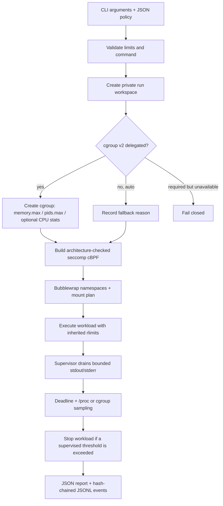

# Architecture and OS concepts

## Execution path

## Key components

### 1. Namespaces and filesystem view

Bubblewrap creates fresh namespaces and constructs a new mount view. The workload capability set is explicitly dropped (`--cap-drop ALL`). Selected system runtime paths are bind-mounted read-only. The process gets a fresh `/proc`, minimal `/dev`, and size-bounded tmpfs mounts for scratch locations. The chosen workspace is mounted at `/workspace`; it is the only host directory intentionally exposed writable by the design. The host home directory and host `/tmp` are not mounted into the sandbox.

The default network namespace is isolated. The `--network` option opts into sharing the host network namespace; that is intentionally an explicit trust decision rather than the default.

### 2. Syscall filtering

`seccomp.py` emits classic-BPF `sock_filter` instructions. The filter checks the kernel audit architecture before comparing syscall numbers; unknown architectures are killed. The x86-64 filter rejects the x32 syscall-number ABI marker to avoid a compatibility-ABI blind spot. The profile returns `EPERM` for listed interfaces such as `ptrace`, `mount`, `setns`, `unshare`, kernel module operations, `bpf`, `userfaultfd`, and `io_uring` setup/entry operations.

This is a **deny-list**, not a complete syscall allow-list. It adds a defense-in-depth layer alongside namespaces and Linux resource controls; it is not proof that all remaining syscalls are harmless.

### 3. Resource enforcement

The supervisor applies inherited per-process rlimits before starting Bubblewrap: CPU time, address space, open descriptors, file size, and disabled core dumps. If cgroup v2 memory and PID controllers are delegated to the invoking process, BlackBoxJail places the workload into a child cgroup and configures `memory.max`, `pids.max`, and swap limits when supported. Aggregate CPU-time accounting is used only when the CPU controller is enabled.

When cgroup delegation is unavailable, `auto` mode records the reason and uses `/proc` sampling for approximate process-tree RSS and process count. It does not claim these sampled measurements are hard aggregate limits. `required` mode refuses to launch without cgroup enforcement.

### 4. Supervision and output backpressure

The parent supervisor uses non-blocking stdout/stderr pipes and a selector loop, storing at most the configured number of bytes per stream. Exceeding a cap causes the workload to be terminated. The loop periodically checks deadlines and resource metrics; it sends termination signals and escalates to `SIGKILL` when required. Workloads are started in a new process session, and the cgroup kill interface is used when available.

### 5. Audit and reports

Each event is canonicalized as JSON and SHA-256 hashed together with its `prev_hash`. The journal uses an append lock so concurrent runs can serialize event additions. Reports are written as per-run JSON files using owner-only permissions on POSIX filesystems. Common secret-bearing command arguments are redacted before being recorded.

The hash chain detects modifications to records when the chain is verified, but no local unsignatured hash chain can stop a privileged attacker from rewriting and rehashing the entire journal. Trusted remote anchoring or signatures are future work.

## Run sequence and observability

The `run_started` event records the sanitized command, workspace and requested limits. Backend-specific events announce cgroup activation or fallback. `sandbox_started` records the backend configuration. The supervisor emits timeout/resource events as needed; `run_finished` records the final status. The JSON report joins the effective policy, backend state, metrics, output and bounded in-memory event buffer for inspection.
